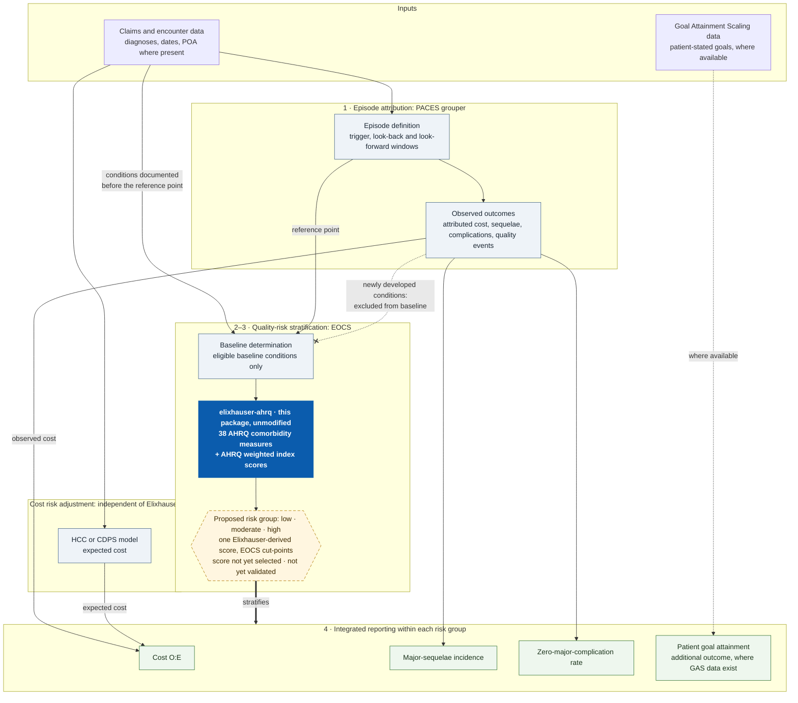

# elixhauser-ahrq

[](https://pypi.org/project/elixhauser-ahrq/)
[](https://opensource.org/licenses/MIT)

**A Python reimplementation of AHRQ's Elixhauser Comorbidity Software Refined for ICD-10-CM, v2027.1 (FY2027).**

It assigns AHRQ's 38 Elixhauser comorbidity measures from the secondary diagnoses on an inpatient discharge. It honours present-on-admission (POA) indicators and AHRQ's POA-exempt lists, and computes AHRQ's two indices: in-hospital mortality and 30-day all-cause readmission. The v2027.1 release covers ICD-10-CM codes from October 2015 through September 2027.

> **Advisory: versions before 2027.1.0 contained errors.**
> - **Wrong weights.** GitHub versions before 2026-05-08 contained incorrect index weights and POA logic.
> - **Defects in 2026.1.0–2026.1.3:**
>   - metastatic cancer suppressed leukemia and lymphoma;
>   - POA-exempt codes were not honoured;
>   - a POA value of `1` was accepted as present on admission;
>   - the cerebrovascular "not present on admission" rule could not fire.
> - **Calculator.** The former Hugging Face calculator treated the first code entered as a comorbidity and gave order-dependent results.
>
> All of these are corrected in 2027.1.0. Results produced with earlier versions should be re-run.
>
> **Read the advisory:** [Advisory EOCS-ELX-2026-01](https://github.com/fopelka-EOCS/elixhauser-ahrq/blob/main/docs/ADVISORY-EOCS-ELX-2026-01.md). Details are in the [CHANGELOG](https://github.com/fopelka-EOCS/elixhauser-ahrq/blob/main/CHANGELOG.md).

This is an independent implementation. It is not produced, reviewed or endorsed by AHRQ.

## Resources

- **Package:** https://pypi.org/project/elixhauser-ahrq/
- **Source and issues:** https://github.com/fopelka-EOCS/elixhauser-ahrq
- **Calculator:** https://huggingface.co/spaces/fopelka/elixhauser-risk-calculator
- **Dataset:** https://huggingface.co/datasets/EOCS-LTD/elixhauser-icd10-mapping

## How EOCS uses Elixhauser: quality-risk stratification of episodes

Episodes of Care Solutions (EOCS) maintains this package. EOCS's primary use of it differs from AHRQ's. **EOCS's proposed method uses an Elixhauser-derived score to group patients within an episode of care into low-, moderate- and high-risk groups by baseline clinical risk**, and then compares quality, cost and patient outcomes within like groups. This section explains how that use differs from AHRQ's, and where this package's role begins and ends.

### Where the Elixhauser measures come from

- **The original measures (1998).** Elixhauser and colleagues developed 30 comorbidity measures for administrative inpatient data. They studied several outcomes: length of stay, hospital charges and in-hospital mortality. Comorbidity effects on these outcomes differed across patient groups, so **the authors cautioned against reducing the measures to a single index, which can lose information** (Elixhauser et al., 1998).
- **AHRQ's indices (2017).** AHRQ later derived two weighted indices from the measures: one for **in-hospital mortality** and one for **30-day all-cause readmission** (Moore et al., 2017). The measures remain the foundation of AHRQ's software; the current refined release defines 38.
- **Measures versus indices.** The measures record which comorbidities are present. Each index is a weighted sum of those measures, calibrated to one outcome. Its weights are not established for any other outcome. This package reproduces AHRQ's measures and both indices exactly. AHRQ publishes no risk groups or cut-points.

EOCS's use returns to the measures' original, broader purpose: describing comorbidity burden across several outcomes. EOCS applies that purpose to episodes of care. It builds on AHRQ's work and does not depart from it: this package applies AHRQ's measures and indices unchanged.

### What EOCS does with it

The package is one step in a separate EOCS episode method:

1. **Episode attribution: the PACES grouper.** The PACES grouper defines each episode: its trigger, and its look-back and look-forward windows. It attributes services, cost, sequelae and quality events to the episode. This is the *observed* side. The grouper's attribution is independent of Elixhauser.
2. **Eligible baseline conditions only.** Only conditions that qualify as baseline risk at the episode's reference point are passed to this package. These are conditions documented before the reference point, and conditions on the index claim that are supported by evidence that they already existed. **Complications and other conditions that newly develop during the episode are never treated as baseline risk.** If they were, a complication would raise the patient's own risk group and hide itself.
3. **Elixhauser measures and score, then risk group.** This package returns AHRQ's full measure set and its index scores for those baseline conditions. Under EOCS's proposed method, each episode is then placed in a low-, moderate- or high-risk group from an Elixhauser-derived score and cut-points specific to the episode type. **The score choice and the cut-points are EOCS's, not AHRQ's. Neither has yet been selected or validated, and neither is part of this package.**
4. **Evaluation within each risk group.** For each group, EOCS reports:
   - **major-sequelae incidence**;
   - the **rate of episodes with zero major complications**;
   - **cost observed-to-expected (O:E)**. Expected cost comes from a separate, independent HCC or CDPS cost-risk model. **The Elixhauser score never enters a cost calculation;**
   - **patient goal attainment**, an additional outcome, evaluated where Goal Attainment Scaling data are available. It is measured against goals the patient has stated. This package does not calculate it, and the Elixhauser score has not been validated to predict it.



*Solid blue: this package. Dashed amber: EOCS's proposed risk groups, not yet validated. The dotted crossed line marks the rule that conditions developing during the episode never become baseline risk. The dotted goal-attainment line marks an outcome evaluated only where Goal Attainment Scaling data exist.*

### What this package does and does not do

- **It does:** apply AHRQ's measures and indices, unmodified, to whatever diagnoses it is given.
- **It does not:** define episodes, decide which diagnoses count as baseline, assign risk groups, compute expected cost, or measure outcomes. Those belong to the calling method. For any episode-based use, pass **eligible baseline diagnoses only**.

### Scientific status: EOCS risk groups are not yet validated

- **The application is EOCS's own.** AHRQ developed its indices for in-hospital mortality and 30-day readmission. AHRQ has not validated them for complications, sequelae, cost performance or goal attainment. EOCS uses the score to *group* episodes, not to predict any one patient's outcome. Whether the groups actually separate those outcomes is an empirical question.
- **EOCS stratification inherits the 1998 caution.** Each EOCS risk group is assigned from a single summary score. That is the reduction the original authors warned can lose information, so validation must be specific to the episode type and to the outcome.
- **Which score to use is a research question, not a settled choice.** Future EOCS research will compare:
  - AHRQ's mortality index;
  - AHRQ's readmission index;
  - an unweighted count of the comorbidity measures;
  - potentially, episode-refined models.

  None of these has been selected or validated for EOCS risk grouping. An episode-refined model would be EOCS's own score, not an AHRQ Elixhauser index, and would be labelled as such.
- **EOCS cut-points are not AHRQ standards, and none is yet validated.** Each must be validated for each episode type and each outcome, on held-out data, before it is reported as validated. Validation covers:
  - discrimination for the outcome;
  - a consistent gradient from low to moderate to high;
  - adequate group sizes;
  - stability across years and payer types.
- **Until then, EOCS risk groupings are provisional.** Results stratified by them should be described as such.

## Installation

```bash
pip install elixhauser-ahrq
```

## Quick start

Give the principal diagnosis separately. AHRQ never maps it. Give each secondary diagnosis with its POA indicator.

```python
>>> from elixhauser_ahrq import score_discharge
>>> r = score_discharge(
...     principal_dx="I214",                                  # NSTEMI: not a comorbidity
...     secondary_dx=["I5022", "E1122", "N186", "C7800", "I69351"],
...     secondary_poa=["Y", "Y", "N", "Y", ""],               # I69351 is POA-exempt
...     discharge_date="2026-11-02",                          # selects AHRQ's FY2027 exempt list
... )
>>> r["present"]
['CANCER_METS', 'CBVD', 'HF', 'DIAB_CX', 'PARALYSIS']
>>> r["mortality_index"], r["readmission_index"], r["partial"]
(43, 25, False)

```

ESRD (`N186`) is not counted: renal failure requires POA = Y or W, and it was coded N.

**Without POA data**, AHRQ cannot assess 18 of the 38 measures. The package returns them as `None`, and the index is flagged as **partial**:

```python
>>> r = score_discharge("I214", ["I5022", "E1122", "N186", "C7800", "I69351"])
>>> r["present"], r["mortality_index"], r["partial"], len(r["not_assessable"])
(['CANCER_METS', 'DIAB_CX'], 20, True, 18)

```

### Rules implemented (from AHRQ's SAS mapping program)

| Rule | Behaviour |
|---|---|
| Principal diagnosis | Never mapped. Only secondary diagnoses are mapped. |
| POA-dependent measures (18) | Counted only if POA = `Y` or `W`, or if the code is on AHRQ's POA-exempt list for the discharge's ICD-10-CM version. `N`, `U`, `1` and blank do not count. |
| No POA data | The 18 POA-dependent measures are not assessable (`None`), and the index is partial. |
| Cerebrovascular disease | Counted if a stroke code is present on admission, or a sequela code is present and no stroke is coded "not present on admission". |
| Exclusions | Complicated diabetes overrides uncomplicated. Complicated hypertension overrides uncomplicated. Metastatic cancer overrides solid tumour and in situ. Solid tumour overrides in situ. Severe liver disease overrides mild. Severe renal failure overrides moderate. Metastatic cancer does **not** override leukemia or lymphoma. |
| ICD-10-CM version | Derived from the discharge date as in AHRQ's program. With no date, AHRQ's default applies (version 44, FY2027). Dates outside October 2015 to September 2027 produce a warning. |

## API

```python
from elixhauser_ahrq import assign_comorbidities, ElixhauserMapper, ElixhauserScorer

res = assign_comorbidities("I214", ["I5022"], ["Y"], discharge_date="2026-11-02")
res.flags            # {measure: True / False / None} for all 38 measures
res.trace            # per-code explanation: AHRQ label, POA, exemption, what was counted

ElixhauserScorer("mortality").calculate_score(res.flags)
ElixhauserScorer("readmission").calculate_score(res.flags)

# Long-format DataFrames: one row per diagnosis, with a sequence column (1 = principal)
flags_df = ElixhauserMapper().map_dataframe(df, "encounter_id", "dx", poa_col="poa",
                                            dx_sequence_col="dx_seq",
                                            discharge_date_col="discharge_date")
scored = ElixhauserScorer("mortality").score_dataframe(flags_df)
```

`ElixhauserMapper().map_patient_diagnoses(codes, poa)` remains for compatibility. It treats `codes[0]` as the principal diagnosis.

## Indices and risk tiers

The indices are AHRQ's in-hospital mortality and 30-day readmission indices (Moore et al., 2017). The weights come from AHRQ's SAS index program, so they match AHRQ exactly. They are **not** the van Walraven (2009) score.

**AHRQ publishes no risk tiers.** `stratify_risk` therefore requires thresholds you have validated for your own population and outcome.

## Intended use and limitations

- **Intended population.** Adult inpatient discharges with ICD-10-CM diagnoses and, ideally, POA indicators. The indices were developed to predict in-hospital mortality and 30-day readmission.
- **Not intended for:** predicting complications or cost; outpatient or professional claims without POA; or individual clinical decisions.
- **Claims without POA.** Inferring POA from claims (for example, with lookback windows) is a user-side assumption that AHRQ does not provide. It has not been validated here.
- **Normalisation, not part of AHRQ's program.** Codes are upper-cased and have decimals removed. POA values are upper-cased. AHRQ's program caps diagnoses at its `NUMDX` setting (40 by default); this package maps every secondary diagnosis given.

## Validation status

This package reimplements AHRQ's Elixhauser Comorbidity Software Refined for ICD-10-CM (SAS programs, v2027.1).

On every build:
- its code lists, POA-exempt lists and weights are regenerated from AHRQ's SAS programs and must be identical;
- its mapping is checked code by code against AHRQ's reference workbook;
- its logic is checked on rule cases and on 40,000 randomized synthetic discharges against an independent transliteration of AHRQ's SAS mapping and index programs.

AHRQ does not publish reference output files. **Pending:** comparison with output from AHRQ's executed SAS software (test tier T7) has not been done. No SAS environment is available to the maintainers; a run-ready kit is in `validation/`.

The package has **not** been comprehensively validated, and it has not been tested on real-world data. See [docs/VALIDATION.md](https://github.com/fopelka-EOCS/elixhauser-ahrq/blob/main/docs/VALIDATION.md) for exactly what has and has not been tested.

## Versioning

`YYYY.R.P`: AHRQ fiscal year, AHRQ release, and the patch of this implementation. Patch releases can change results when they correct defects; the CHANGELOG says so whenever they do.

| Package | AHRQ release | Codes | Status |
|---|---|---|---|
| 2027.1.0 | v2027.1 (FY2027) | 4,573 | Current |
| 2026.1.0–2026.1.3 | v2026.1 | 4,567 | **Superseded. Contains defects; do not use.** |

## Citation

See [CITATION.cff](https://github.com/fopelka-EOCS/elixhauser-ahrq/blob/main/CITATION.cff). Please also cite AHRQ's software:

> Agency for Healthcare Research and Quality. Elixhauser Comorbidity Software Refined for ICD-10-CM, v2027.1. Healthcare Cost and Utilization Project (HCUP). https://hcup-us.ahrq.gov/toolssoftware/comorbidityicd10/comorbidity_icd10.jsp

## About EOCS

This package is maintained by Episodes of Care Solutions (EOCS), [www.eocs.ltd](https://www.eocs.ltd). EOCS separately offers **EOCS Analytics**, a commercial product for episode-based analytics. Its methods, including any risk stratification, are EOCS's own. They are not part of this package and not part of AHRQ's software.

Neither this package nor any EOCS product is affiliated with, reviewed or endorsed by AHRQ or any other government agency.

## License and attribution

MIT License. The code lists and weights come from AHRQ HCUP's Elixhauser Comorbidity Software Refined for ICD-10-CM, which AHRQ provides for public use. AHRQ's SAS programs, reference file, change log and user guide are included unmodified in `SAS-Programs/`.

## References

- Elixhauser A, Steiner C, Harris DR, Coffey RM. Comorbidity measures for use with administrative data. *Medical Care* 1998;36(1):8–27.
- Moore BJ, White S, Washington R, Coenen N, Elixhauser A. Identifying increased risk of readmission and in-hospital mortality using hospital administrative data: the AHRQ Elixhauser Comorbidity Index. *Medical Care* 2017;55(7):698–705.
